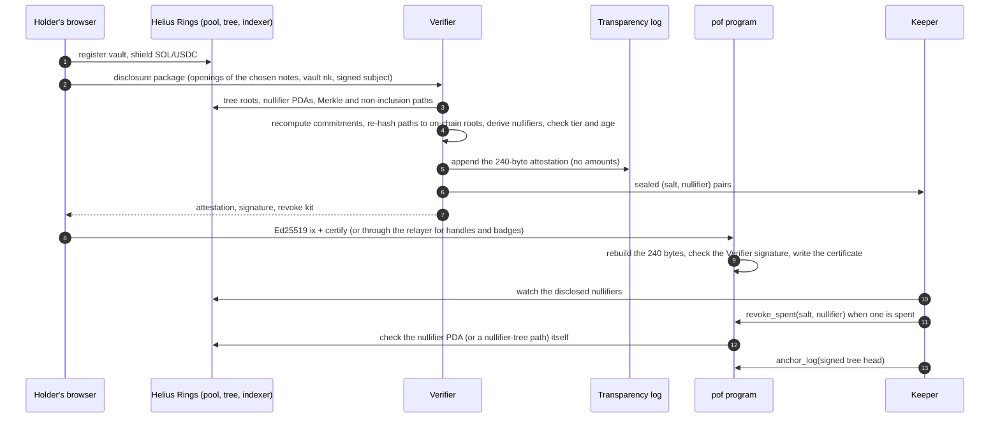

# Proof of Funds

A live, public certificate that a subject (a Solana wallet, an X handle, or a fresh badge key) holds **at least** a tier of
SOL or USDC in a [Helius Privacy Ring](https://www.helius.dev/blog/solana-privacy-rings). The certificate never carries an
amount. It is revoked on chain when one of the notes behind it is spent, proven from the Rings program's own accounts.

| | |
|---|---|
| `pof` program | `pofP4QRRDXnmDN9CNYiAGHfwMEgM7sLWhVcUMpsbynT` |
| `pof_gate` program (Rooms) | `gatSToJMD8ZPLa85fKj6seYHUtYx4ah3ptZvLkisLPU` |
| The paper | [`docs-src/`](docs-src/abstract.md), served at `/docs`; the two-page [litepaper](docs-src/litepaper.md) |
| What you trust | [`docs-src/trust.md`](docs-src/trust.md): read it first |
| Every byte | [`CONTRACT.md`](CONTRACT.md) |
| The Rings facts it relies on | [`RINGS.md`](RINGS.md), checked against mainnet reads |
| Building on it | [`docs-src/developers.md`](docs-src/developers.md) |
| Reporting a vulnerability | [`SECURITY.md`](SECURITY.md) |

## How it works



## Components

| folder | what | language | tests |
|---|---|---|---|
| [`program/`](program/) | the `pof` and `pof_gate` Anchor programs, their IDLs, launch and wind-down scripts | Rust, JS | unit + local-validator suite (`program/test/all.sh`) |
| [`verifier/`](verifier/) | the Verifier, the RFC 9162 transparency log, the relayer, the keeper, the X linker, rate limits; one deterministic bundle | TypeScript | `node --test` (`verifier/test/`) |
| [`client/`](client/) | the browser client: Rings SDK and Poseidon WASM in the page, vault, register, shield, sync, note choice, disclosure, kits | JS | vectors from mainnet data, local end-to-end, headless lab |
| [`lab/`](lab/) | a plain harness page and a local validator with the Rings programs cloned from mainnet | JS, zsh | drives the whole flow |
| [`sdk/`](sdk/) | `@pof/sdk`: read certificates from chain, hash subjects, verify log proofs, build CPI accounts | TypeScript | unit + local-validator suite |
| [`api/v1/`](api/v1/) | the read API (`/v1`), OpenAPI 3.1 in [`api/openapi.json`](api/openapi.json) | JS | `node --test api/v1/_test/` |
| [`api/attest`, `relay`, `link`, `keeper`](api/) | the Verifier's Vercel functions (thin wrappers over `verifier/dist`) | JS | in `verifier/test/` |
| [`api/status/`](api/status/) | the status checks and their uptime history | JS | `node --test api/status/_test/` |
| [`mcp/`](mcp/) | the MCP server (stdio and Streamable HTTP at `/mcp`), read-only tools | JS | `node --test mcp/test/` |
| [`bots/`](bots/) | the Telegram gate bot and the Discord role bot | JS | `node --test bots/test/` |
| [`witness/`](witness/) | an independent log monitor: checks each signed head against the chain and the heads before it, cosigns or raises an alarm (CONTRACT §8) | JS | `witness/test/` |
| [`cli/`](cli/) | `pof check`, `watch`, `rooms`, `config`, `stats`, `log head`, `log proof`, `log verify` | JS | `cli/` tests |
| [`embed/`](embed/) | `<pof-badge>`, a web component showing a certificate live | JS | headless Chromium |
| [`zk/`](zk/) | phase 2: the Groth16 circuit, its setup, the browser prover, `certify_zk` (in development, not deployed; [`docs-src/zk.md`](docs-src/zk.md)) | circom, JS | `zk/test/` |
| [`audit/`](audit/) | the internal security review's failing proofs, one per finding | JS | `node --test audit/test/` |
| [`docs-src/`](docs-src/) | the paper, one Markdown page per section | Markdown | |

## Run it locally

Requirements: Node 20 or newer; for the programs, the Solana CLI, Anchor and the Rust toolchain in
`program/rust-toolchain.toml`. Nothing below sends a mainnet transaction.

```sh
git clone https://github.com/liakh10/pof && cd pof
npm ci                                   # the root dependency (@vercel/blob) for the functions

# the Verifier: tests, and a reproducibility check of the published bundle hash
(cd verifier && npm ci && npm test && npm run build:check)

# the SDK, the API, the MCP server, the bots, the status checks (no network; fakes and mocks)
(cd sdk && npm ci && npm test)
node --test api/v1/_test/ api/status/_test/ bots/test/
(cd mcp && npm ci && npm test)

# a local validator with the Rings programs and tree cloned from mainnet (read-only dumps)
node lab/rings-local/prep.mjs
zsh lab/rings-local/chain.sh start
# the client: vectors from mainnet data, then the local end-to-end against the real Verifier
(cd client && npm ci && npm test)
node lab/serve.mjs                       # the lab page: http://localhost:5491/lab/
zsh lab/rings-local/chain.sh stop

# the programs: build, then unit tests, the local-validator suite and the wind-down
(cd program && npm ci && zsh test/build.sh && node test/prep.mjs && zsh test/all.sh)
```

Environment for the functions (Vercel, or a local `.env` you do not commit): `SOLANA_RPC` (comma-separated nodes),
`POF_PROGRAM`, `HELIUS_API_KEY` and `HELIUS_SPR_URL` for the Rings indexer, `POF_VERIFIER_KEY`, `POF_RELAYER_KEY`,
`POF_SEAL_KEY`, `BLOB_READ_WRITE_TOKEN`, `CRON_SECRET`. Keys are generated by `verifier/scripts/keys.mjs` straight into
`~/.config/pof/` (mode 600) and never printed. Before launch every cron is parked in
[`vercel.crons.json`](vercel.crons.json) and the keeper stays off (`POF_KEEPER_LIVE` unset).

## Test reports

| report | covers |
|---|---|
| [`reports/devx.md`](reports/devx.md) | SDK, read API, MCP server, bots, and their run against a local validator |
| [`reports/rings.md`](reports/rings.md) | the browser client, the lab and the local end-to-end against the real Verifier |
| [`reports/program.md`](reports/program.md) | the programs: unit tests, the local-validator suite, wind-down, rehearsal, own-CA, compute units, rent |
| [`reports/verifier.md`](reports/verifier.md) | the Verifier, the log, the relayer, the keeper, the linker, and the local end-to-end |
| [`reports/zk.md`](reports/zk.md) | phase 2: circuit parity, constraints, the development setup, the browser prover |
| [`reports/audit.md`](reports/audit.md) | the internal security review: scope, method, findings with status and failing tests |
| [`reports/audit2.md`](reports/audit2.md) | the second internal review, with failing tests in `audit2/test/` |
| [`reports/fuzz.md`](reports/fuzz.md) | the programs under random and hostile instruction sequences (an independent reviewer), with repro files in `fuzz/` |

Other parts publish their reports in `reports/` as they land; the [changelog](CHANGELOG.md) lists each one.

## Status of this code

Pre-launch. The programs are not deployed on mainnet; the keeper and every cron are off; the Verifier key and the relayer
key exist only in the deployment's environment. Findings of the internal review are open until their tests pass
([`reports/audit.md`](reports/audit.md)). This is not anonymity software: read
[the privacy guidance](docs-src/privacy.md) before you certify.

## License

[Apache-2.0](LICENSE).
