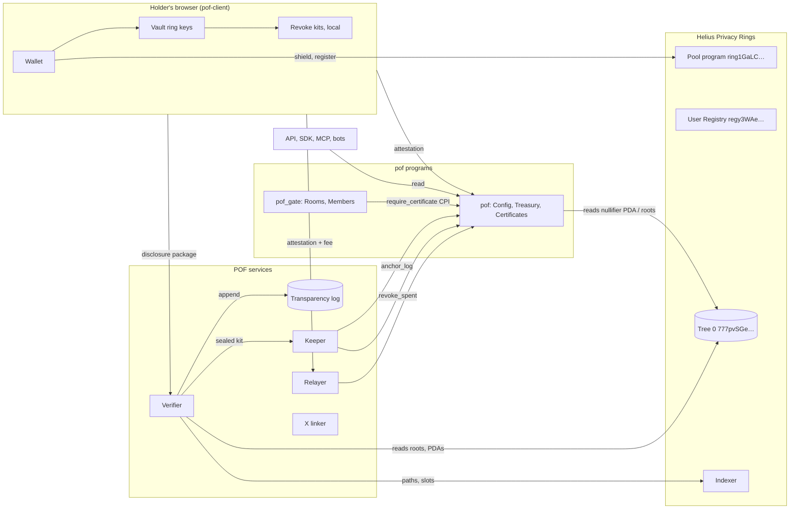

# System model

## Parties

**Holder.** Has a Solana wallet and wants a certificate for a subject. Holds the wallet key, the vault ring keys derived
from one wallet signature, and the revoke kits.

**Subject.** What the certificate is about: a wallet (kind 0), an X handle (kind 1) or a badge key made for this
certificate (kind 2). On chain the subject is a 32-byte hash (CONTRACT §1).

**Controller.** The key that may revoke the certificate and join Rooms with it. For a wallet or a badge it is the subject
key itself; for an X handle it is a key the client derives for that handle from the vault seed, so it can be rebuilt on any
device by signing the same vault message again.

**Browser client** (`client/pof-client.js`). Runs the Rings SDK and its Poseidon WASM in the page. It derives the vault,
registers it in the User Registry, shields SOL or USDC into it, syncs and decrypts its notes, picks the fewest notes that
reach a tier, signs the subject statement, builds the disclosure package and keeps the revoke kits (exportable as a
file). Nothing secret leaves the page except the package sent to the Verifier.

**Vault ring.** A Privacy Ring whose Ed25519 owner key is `sha256("pof/vault/v1" ‖ signature)` over a fixed plain-text
message the wallet signs. It is recoverable from the wallet alone, and separate from the wallet's own ring, so the
nullifier key the Verifier sees is never the main ring's.

**Verifier** (`verifier/`). Checks a disclosure package against chain state and signs the 240-byte attestation, or refuses
with a specific error code. Appends each signed attestation to the transparency log. Holds the ed25519 signing key. Keeps
no amount, no opening and no nullifier key.

**Transparency log.** An append-only Merkle log (RFC 9162 hashing) of every attestation the Verifier signs. Its signed
tree head is anchored on chain with `anchor_log`. Holds no amounts, openings, nullifiers or salts.

**Relayer.** A funded key that submits `certify` for X-handle and badge subjects, so the holder's wallet never signs a
public transaction that names the certificate. The holder pays it the fee, the rent and the network fee in one transfer,
from any wallet or as a Ring withdrawal. It refuses wallet subjects (a wallet certificate is submitted by the wallet). It
caps its own spend over a rolling 24-hour window and keeps a balance floor.

**Keeper.** Holds each certificate's revocation pairs (salt, nullifier), sealed with AES-256-GCM, watches whether any
disclosed nullifier is spent and calls `revoke_spent` when one is. Also anchors the log head on chain. Off before launch.

**X linker.** Issues a one-time code for a handle, reads the post that carries it through fxtwitter, and on a match issues a
link id: the Verifier's own signature over the handle and an expiry. Keeps only a hash of the code, for at most 30 minutes.

**`pof` program** (`pofP4QRRDXnmDN9CNYiAGHfwMEgM7sLWhVcUMpsbynT`). Rebuilds and checks attestations, keeps the
certificates, the Config (keys, fee, tier tables) and the Treasury (fees and public counters), verifies spends against the
Rings accounts, and offers the CPI gate `require_certificate`.

**`pof_gate` program** (`gatSToJMD8ZPLa85fKj6seYHUtYx4ah3ptZvLkisLPU`). Rooms with an asset and a minimum tier. A
controller joins with a live certificate; anyone evicts a member whose certificate is no longer good enough. No fees, no
admin. The bots read it.

**Readers.** Anyone: the `/v1` API, `@pof/sdk`, the MCP server, the Telegram and Discord bots, other programs by CPI.

## What each party holds

| party | holds | can | cannot |
|---|---|---|---|
| Holder | wallet key, vault keys, kits | certify, renew, revoke, spend | make a tier the notes do not reach |
| Verifier | signing key | sign attestations, append the log | move funds, revoke, keep a certificate alive after a spend is shown |
| Admin | admin key = program upgrade authority | pause, rotate the Verifier key after a delay, set the fee up to the cap, upgrade the program | sign attestations, change an issued tier's meaning |
| Relayer | relayer key | pay for and submit `certify` | sign attestations; it can only submit one the Verifier signed naming it as payer |
| Keeper | seal key, kits | revoke a spent certificate, anchor the log | revoke an unspent one (the program checks the spend) |
| Anyone | the chain | `revoke_spent` with a pair, `expire` after expiry, `evict` in Rooms, audit the log | revoke without a spent nullifier and its salt |

## Accounts on chain

| account | seeds (program) | holds |
|---|---|---|
| Config | `["config"]` (pof) | admin, dev, relayer, verifier, next verifier and its slot, $ROOT mint, parameters, tier tables, paused, closing |
| Treasury | `["treasury"]` (pof) | the fees, and counters: certified, renewed, revoked, expired, live, sum of live tier minimums, relayed, exempt, the anchored log head |
| Certificate | `["cert", subject_hash, [asset]]` (pof) | subject kind and hash, asset, tier, status, slots, tree root, the sorted salted nullifier hashes, payer, controller, the Verifier key that signed, the log index, and after a spend the revealed pair |
| Room | `["room", creator, id]` (pof_gate) | asset, minimum tier, open, name, counters |
| Member | `["member", room, subject_hash]` (pof_gate) | the certificate it joined with, the controller, the payer |

One subject has at most one certificate per asset. The full field list is CONTRACT §6.

## Network assumptions

- Slots are the only clock. Every window in the protocol is a count of slots read from the chain.
- The Solana RPC answers honestly about account state at `confirmed` commitment. A lying RPC can make the Verifier refuse
  or, together with a lying indexer, sign over a root that is not real; the program then rejects the attestation only if
  it fails its own checks (the root itself is bound by the Verifier's signature, not re-read on chain).
- Rings tree 0 (`777pvSGe…`) is the only tree; all notes of one attestation must be in it.
